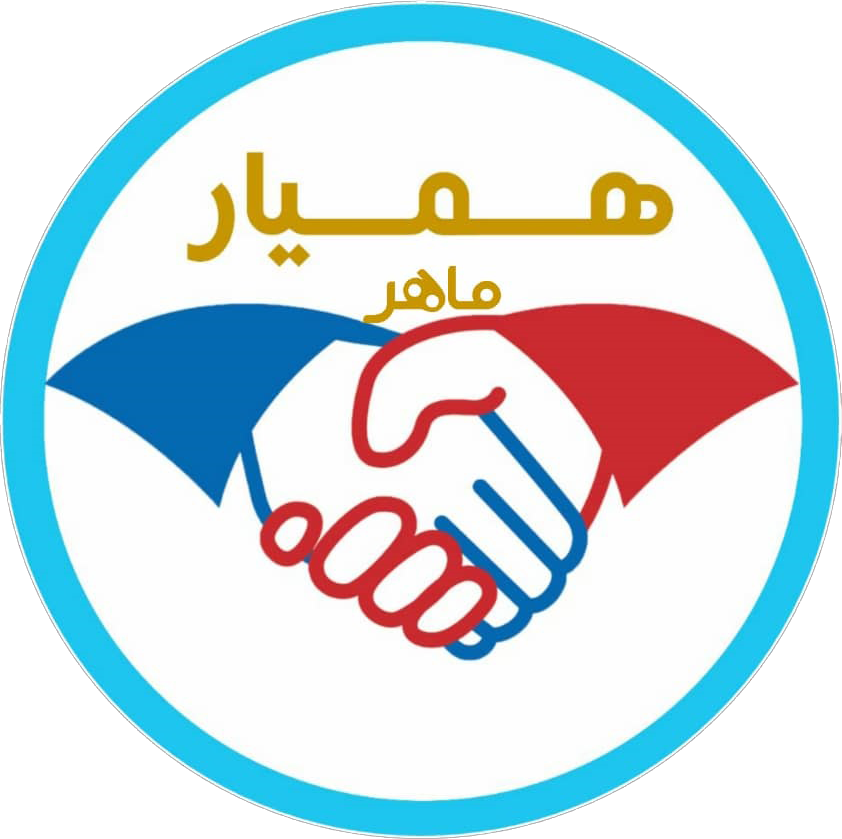
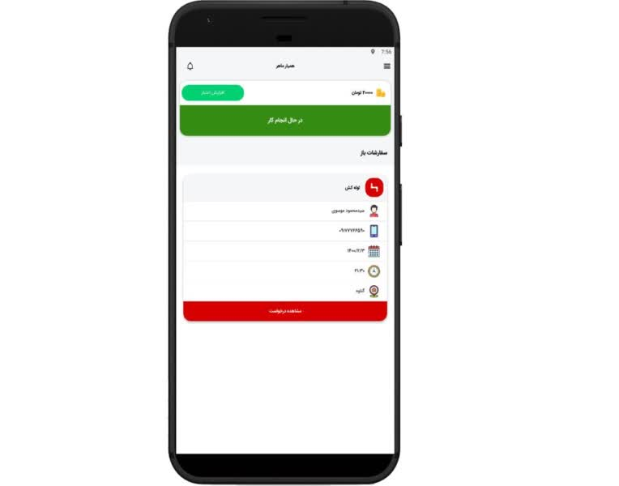
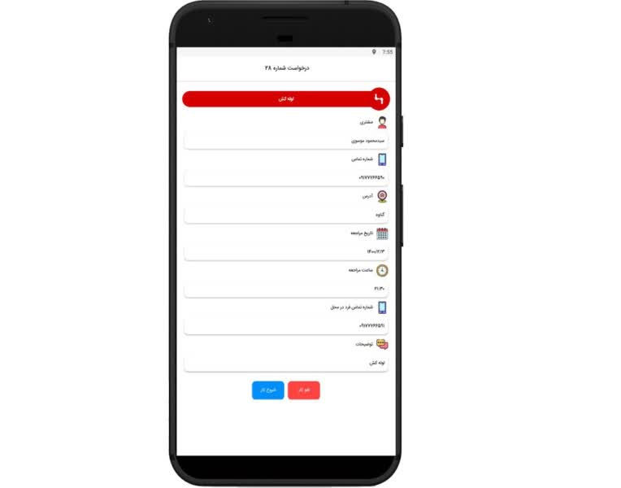
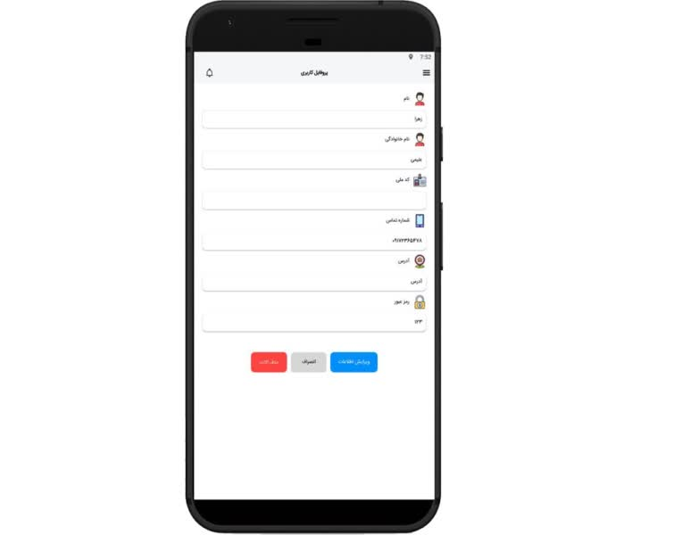
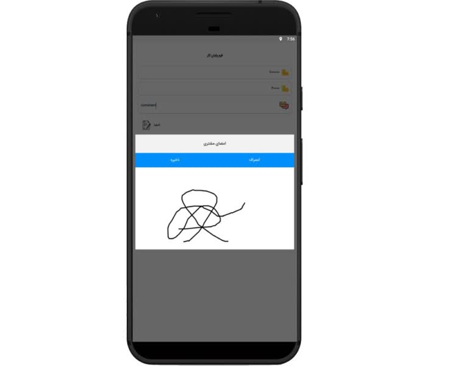
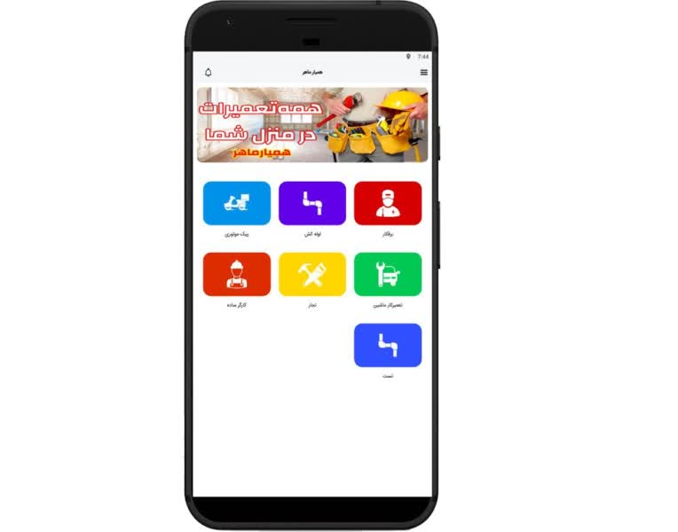

# همیار ماهر

### سامانه ارتباط کاربران با متخصصان و ارائه خدمات

---

## معرفی پروژه

**همیار ماهر** یک اپلیکیشن اندرویدی با هدف تسهیل ارتباط میان کاربران و متخصصان، ثبت درخواست خدمات و مدیریت فرآیند دریافت خدمات است.

این سامانه بستری برای معرفی خدمات، ثبت درخواست و پیگیری سفارش‌ها فراهم می‌کند تا کاربران بتوانند راحت‌تر خدمات موردنیاز خود را دریافت کنند.

## تصاویر اپلیکیشن

<table border="0" cellspacing="12" cellpadding="0">
  <tr>
    <td width="33%">
      
    </td>
    <td width="33%">
      
    </td>
    <td width="33%">
      
    </td>
  </tr>
  <tr>
    <td width="33%">
      
    </td>
    <td width="33%">
      
    </td>
  
  </tr>
</table>

## امکانات و قابلیت‌ها

- ثبت‌نام و ورود کاربران
- مشاهده و بررسی خدمات
- ثبت درخواست دریافت خدمات
- ارتباط کاربران با متخصصان
- مدیریت درخواست‌ها و سفارش‌ها
- مشاهده اطلاعات و جزئیات خدمات

## تکنولوژی‌های استفاده‌شده

### Android

- Java
- XML
- Android SDK
- Retrofit
- Gson
- Material Components

### Backend

- PHP
- Laravel
- MySQL
- RESTful API

## معماری و ارتباط با سرور

اپلیکیشن اندروید از طریق APIهای مبتنی بر REST با بک‌اند ارتباط برقرار می‌کند.

بخش سرور با فریم‌ورک Laravel توسعه داده شده و اطلاعات موردنیاز اپلیکیشن در پایگاه داده MySQL ذخیره و مدیریت می‌شوند.

## مسئولیت من در توسعه پروژه

این پروژه به‌صورت فریلنسری و به‌طور کامل توسط من از صفر تا صد توسعه داده شده است.

مسئولیت تمام مراحل شامل تحلیل نیازمندی‌ها، طراحی و پیاده‌سازی اپلیکیشن اندروید، توسعه بک‌اند، طراحی پایگاه داده و پیاده‌سازی ارتباط میان اپلیکیشن و سرور بر عهده من بوده است.

## اطلاعات فنی پروژه

| مشخصات | توضیحات |
|:---|:---|
| نام پروژه | همیار ماهر |
| نوع پروژه | اپلیکیشن خدماتی |
| پلتفرم | Android |
| زبان توسعه اندروید | Java |
| زبان بک‌اند | PHP |
| فریم‌ورک بک‌اند | Laravel |
| پایگاه داده | MySQL |
| ارتباط با سرور | REST API |

---

**توسعه‌یافته توسط عاطفه زنگویی**

Full-Stack Android Developer

