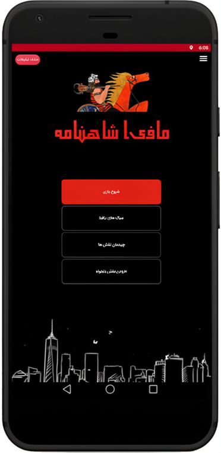
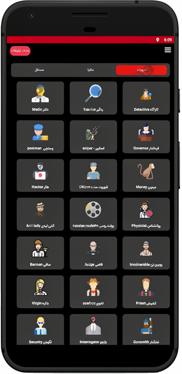
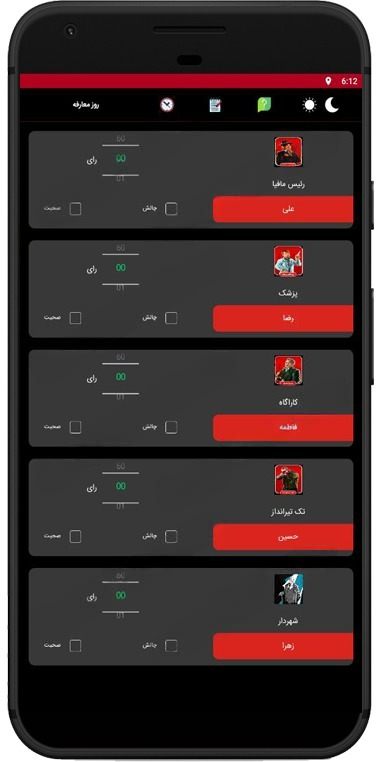
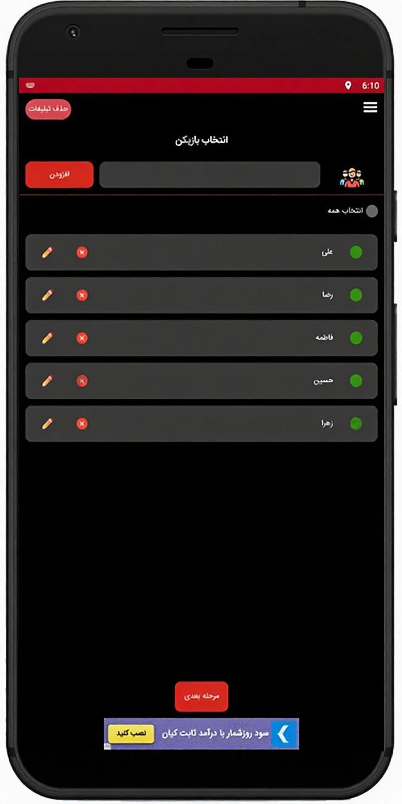
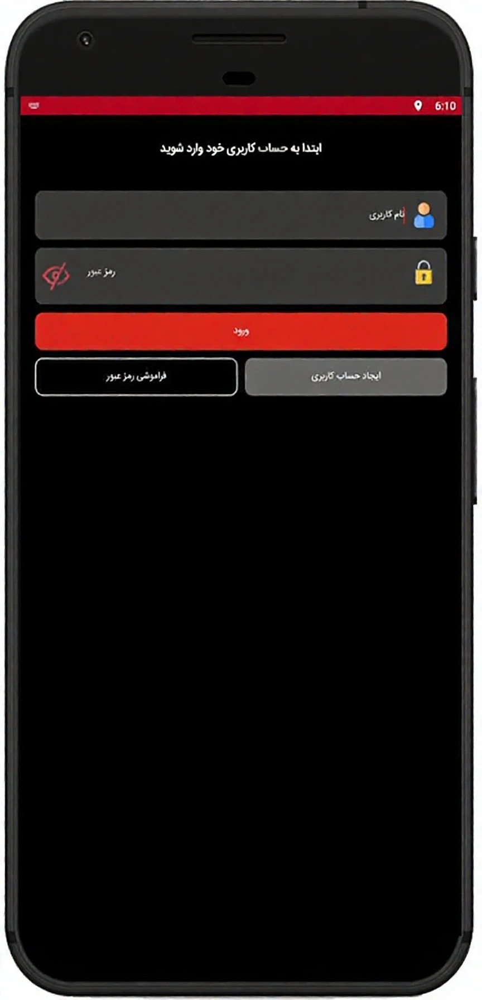

# شاهنامه مافیا | Shahnameh Mafia

### اپلیکیشن مدیریت و اجرای بازی مافیا با الهام از دنیای شاهنامه

---

## 📌 معرفی پروژه

**شاهنامه مافیا** یک اپلیکیشن اندرویدی با هدف مدیریت و تسهیل اجرای بازی مافیا است که امکانات متنوعی را برای مدیریت بازیکنان، نقش‌ها، چیدمان بازی و تعاملات حین بازی در اختیار کاربران قرار می‌دهد.

این اپلیکیشن با در نظر گرفتن نیازهای بازیکنان و گردانندگان بازی طراحی و توسعه داده شده و تلاش می‌کند فرآیند آماده‌سازی، مدیریت و اجرای بازی را ساده‌تر و منظم‌تر کند.

توسعه این محصول به‌صورت مستقل و از صفر تا صد توسط من انجام شده است؛ از طراحی و پیاده‌سازی اپلیکیشن Android گرفته تا توسعه کامل Backend، طراحی APIها و مدیریت پایگاه داده.

## 📱 تصاویر محیط اپلیکیشن

<table border="0" cellspacing="12" cellpadding="0">
  <tr>
    <td width="33%">
      
    </td>
    <td width="33%">
      
    </td>
    <td width="33%">
      
    </td>
  </tr>
  <tr>
    <td width="33%">
      
    </td>
    <td width="33%">
      
    </td>
    <td width="33%">
      
    </td>
  </tr>
</table>

## ✨ امکانات و قابلیت‌ها

- مدیریت بازیکنان و اطلاعات کاربران
- مدیریت نقش‌های بازی و مشخصات آن‌ها
- امکان تعریف و مدیریت نقش‌های دلخواه
- مدیریت سبک‌های مختلف بازی مافیا
- تنظیم تعداد بازیکنان و چیدمان بازی
- تخصیص تصادفی یا انتخاب نقش‌ها
- ابزارهای موردنیاز گرداننده برای مدیریت روند بازی
- تایمر و زمان‌سنج اختصاصی
- پخش موسیقی و صداهای موردنیاز حین بازی
- بخش قوانین و راهنمای بازی
- امکان ثبت و مدیریت یادداشت‌ها
- سیستم پیام‌رسانی و ارتباط با کاربران

## 🛠 تکنولوژی‌ها و ابزارهای توسعه

### Android Development
- Java
- Android SDK
- XML
- AndroidX
- Material Components
- Retrofit
- Gson
- Glide
- Picasso

### Backend Development
- PHP
- Laravel
- RESTful API

### Database
- MySQL

## 🏗 معماری و ساختار فنی

ساختار پروژه بر اساس معماری Client-Server طراحی شده است.

اپلیکیشن Android به‌عنوان بخش Client، درخواست‌های موردنیاز را از طریق API به Backend ارسال می‌کند و پاسخ‌های دریافتی را پردازش و در رابط کاربری نمایش می‌دهد.

بخش Backend با استفاده از PHP و Laravel توسعه داده شده و مسئولیت پردازش درخواست‌ها، مدیریت منطق سمت سرور و ارتباط با پایگاه داده MySQL را بر عهده دارد.

ارتباط میان Android و Backend با استفاده از Retrofit و تبادل داده‌ها با فرمت JSON انجام می‌شود.

## 👩‍💻 مسئولیت‌های توسعه

در این پروژه مسئولیت کامل تحلیل، طراحی، پیاده‌سازی و توسعه محصول بر عهده من بوده است.

**Android Development**
- توسعه کامل اپلیکیشن Android با Java
- طراحی و پیاده‌سازی رابط کاربری با XML
- پیاده‌سازی قابلیت‌ها و منطق سمت کاربر
- اتصال اپلیکیشن به APIهای Backend
- مدیریت درخواست‌ها و پاسخ‌های سرور

**Backend Development**
- طراحی و توسعه Backend با PHP و Laravel
- طراحی و پیاده‌سازی APIها
- پیاده‌سازی منطق سمت سرور
- طراحی و مدیریت پایگاه داده MySQL
- پیاده‌سازی ارتباط میان Backend و اپلیکیشن

## 🔒 مالکیت و دسترسی به سورس‌کد

این پروژه به‌صورت مستقل و از صفر تا صد توسط من توسعه داده شده است.

با توجه به ماهیت پروژه و مالکیت سورس‌کد، کدهای اصلی اپلیکیشن و Backend در این مخزن منتشر نشده‌اند. این مخزن صرفاً با هدف معرفی پروژه، نمایش قابلیت‌ها و ارائه نمونه‌کار ایجاد شده است.

## 📋 اطلاعات پروژه

| مشخصات | توضیحات |
|---|---|
| نام پروژه | شاهنامه مافیا |
| نوع پروژه | Android Application |
| پلتفرم | Android |
| زبان Android | Java |
| رابط کاربری | XML |
| Backend | PHP / Laravel |
| Database | MySQL |
| نقش توسعه‌دهنده | Full-Stack Android Developer |
| مسئولیت توسعه | صفر تا صد |

---

**طراحی، توسعه و پیاده‌سازی کامل توسط عاطفه زنگویی**

