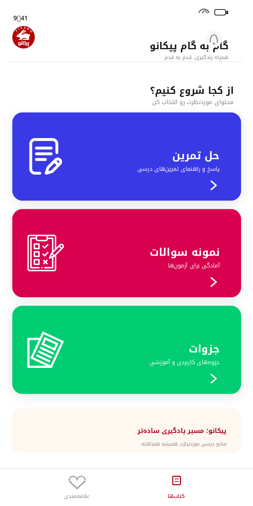
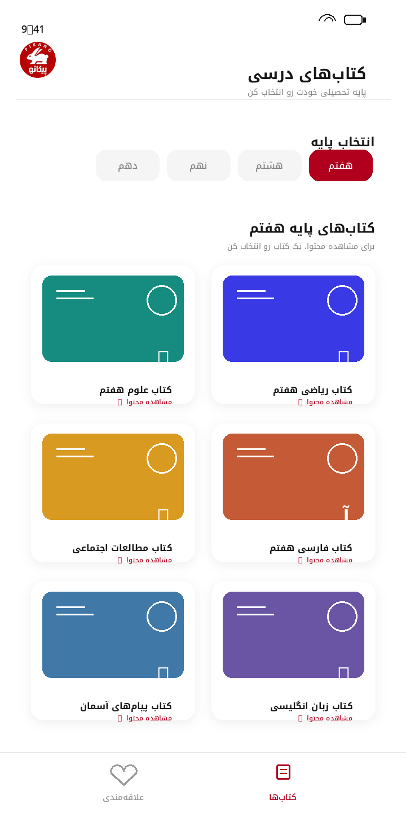
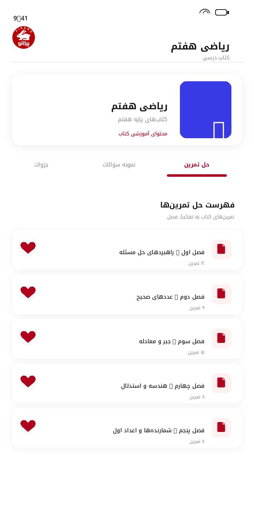
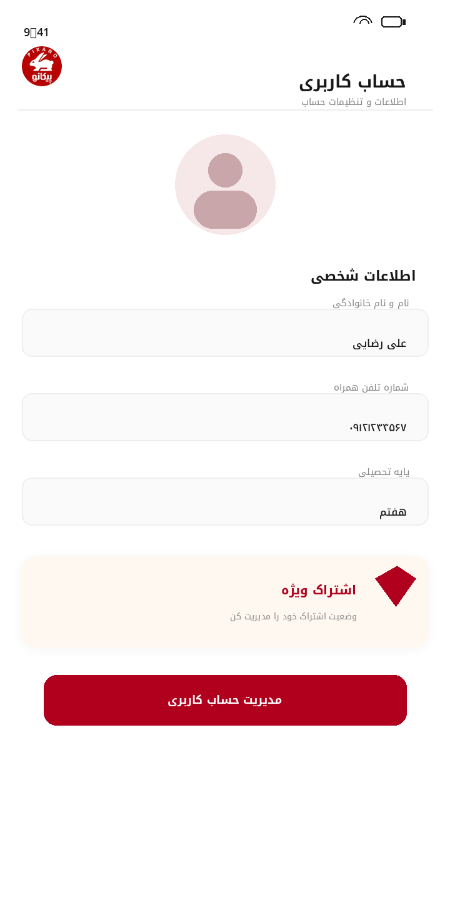
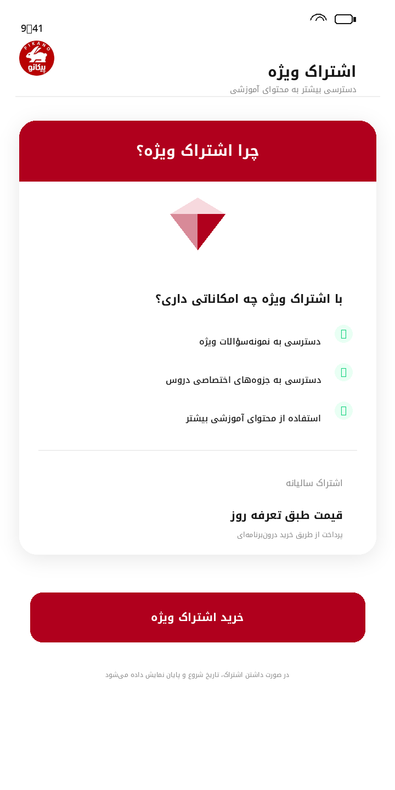
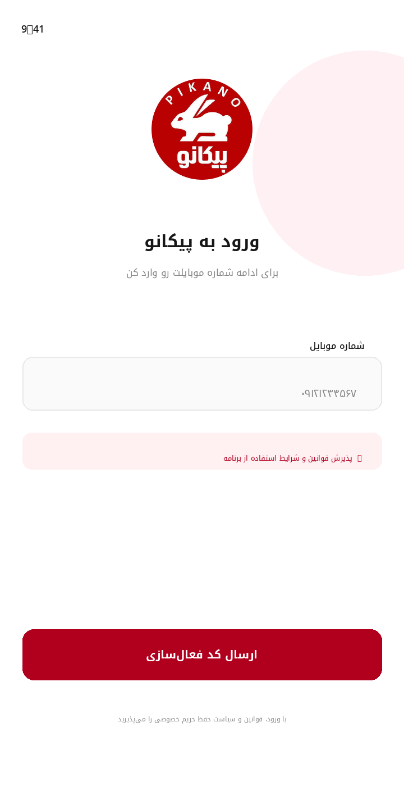

# گام به گام پیکانو

### اپلیکیشن کمک‌آموزشی دانش‌آموزان

**پیکانو** بستری برای دسترسی دانش‌آموزان به کتاب‌های درسی، حل تمرین‌ها، نمونه‌سؤالات و جزوه‌های آموزشی است. کاربران می‌توانند بر اساس پایه تحصیلی خود به محتوای آموزشی دسترسی داشته باشند و از امکاناتی مانند ذخیره مطالب، پیام‌رسانی، اعلان‌ها و اشتراک ویژه استفاده کنند.

---

## درباره پروژه

پیکانو با هدف ساده‌تر کردن دسترسی به منابع کمک‌آموزشی توسعه داده شد. ساختار برنامه بر پایه انتخاب پایه تحصیلی، نمایش کتاب‌ها و ارائه محتوای مرتبط با هر کتاب شکل گرفته است. محتوای هر کتاب در بخش‌های مجزای **حل تمرین، نمونه سؤالات و جزوات** در اختیار کاربر قرار می‌گیرد.

## امکانات اصلی

- انتخاب پایه تحصیلی و مشاهده کتاب‌های مرتبط
- نمایش محتوای آموزشی به تفکیک کتاب
- دسترسی به حل تمرین‌ها، نمونه سؤالات و جزوه‌ها
- مشاهده فایل‌های آموزشی PDF
- ثبت‌نام و ورود با شماره موبایل و کد تأیید پیامکی
- تکمیل و مدیریت اطلاعات حساب کاربری
- ذخیره مطالب در بخش علاقه‌مندی‌ها
- دریافت اعلان‌ها و پیام‌های برنامه
- ارتباط و پیام‌رسانی با مدیر برنامه
- ارائه اشتراک ویژه و خرید درون‌برنامه‌ای
- نمایش تبلیغات درون‌برنامه‌ای

## پیش‌نمایش صفحات اپلیکیشن

صفحات زیر بر اساس ساختار `XML Layout`ها و منابع گرافیکی موجود در سورس پروژه بازسازی شده‌اند. تصاویر، اسکرین‌شات مستقیم از اجرای اپلیکیشن نیستند؛ چون در فایل ارسالی تصویر ثبت‌شده از اجرای برنامه وجود نداشت. نام برخی کتاب‌ها و فصل‌ها نیز برای نمایش چیدمان، داده نمونه است.

### صفحه اصلی

صفحه اصلی با دسترسی مستقیم به حل تمرین، نمونه سؤالات و جزوات.

### فهرست کتاب‌ها

انتخاب پایه تحصیلی و مشاهده کتاب‌های مربوط به آن.

### جزئیات کتاب و محتوای آموزشی

دسته‌بندی محتوای هر کتاب در بخش‌های حل تمرین، نمونه سؤالات و جزوات.

### حساب کاربری

نمایش و مدیریت اطلاعات کاربر و وضعیت اشتراک ویژه.

### اشتراک ویژه

معرفی امکانات اشتراک و دسترسی به محتوای ویژه.

### ورود با شماره موبایل

ورود و شروع فرایند احراز هویت پیامکی.

## تکنولوژی‌ها و ابزارها

| بخش | فناوری‌ها |
|---|---|
| توسعه اپلیکیشن اندروید | Java، Android SDK، XML |
| ارتباط با سرور | Retrofit 2، REST API، JSON |
| توسعه بک‌اند | PHP، Laravel |
| پایگاه داده | MySQL، SQLite |
| پردازش داده | Gson، SharedPreferences |
| نمایش تصاویر | Glide، Picasso |
| تبلیغات | Tapsell Plus |
| پرداخت درون‌برنامه‌ای | In-App Billing |
| نمایش فایل | Android PDF Viewer |

## مسئولیت‌های توسعه

توسعه پروژه از صفر تا صد توسط من انجام شده و شامل طراحی و پیاده‌سازی اپلیکیشن اندروید و توسعه بک‌اند بوده است.

- طراحی و پیاده‌سازی رابط کاربری با `XML`
- توسعه صفحات و جریان‌های اصلی اپلیکیشن با `Java`
- پیاده‌سازی ارتباط اپلیکیشن با سرور از طریق `Retrofit`
- توسعه APIهای موردنیاز با `PHP` و `Laravel`
- طراحی و مدیریت ساختار داده در `MySQL`
- پیاده‌سازی ورود و احراز هویت پیامکی
- توسعه مدیریت کاربران و اطلاعات پایه تحصیلی
- پیاده‌سازی بخش کتاب‌ها و محتوای آموزشی
- پیاده‌سازی علاقه‌مندی‌ها و مدیریت محتوای ذخیره‌شده
- یکپارچه‌سازی سرویس اعلان و پیام‌رسانی
- پیاده‌سازی مشاهده فایل‌های PDF
- یکپارچه‌سازی تبلیغات و خرید درون‌برنامه‌ای
- توسعه سیستم اشتراک ویژه و مدیریت دسترسی به محتوای ویژه

## ساختار کلی راهکار

**اپلیکیشن اندروید** مسئول نمایش رابط کاربری، مدیریت تعاملات کاربر، نمایش محتوای آموزشی، نگهداری داده‌های محلی و ارسال درخواست‌ها به سرور است.

**بک‌اند** مسئول پردازش درخواست‌ها، مدیریت کاربران و محتوای آموزشی، احراز هویت، عملیات مرتبط با اشتراک و ارتباط با پایگاه داده است. ارتباط میان اپلیکیشن و بک‌اند از طریق API انجام می‌شود.

---

**پیکانو | طراحی و توسعه کامل اپلیکیشن اندروید و بک‌اند**

