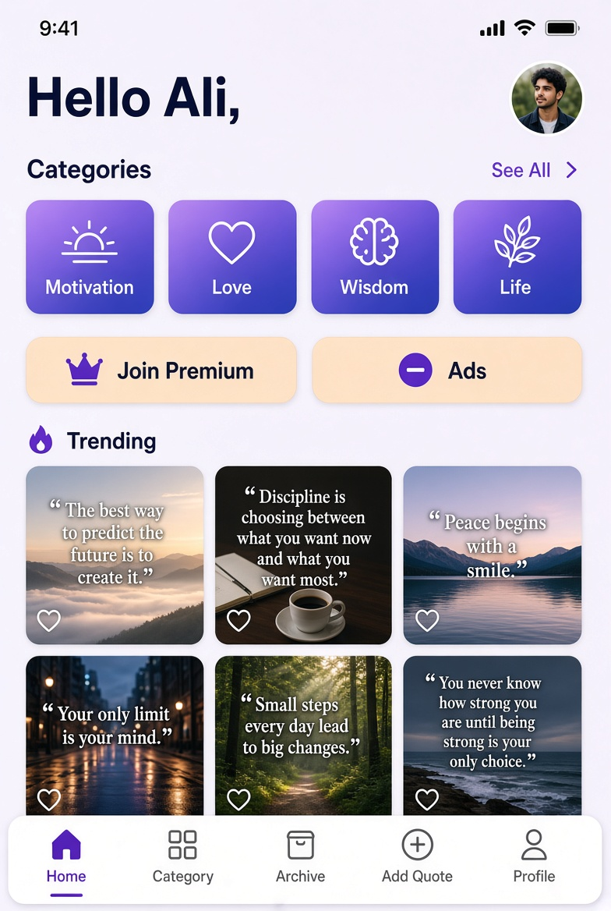
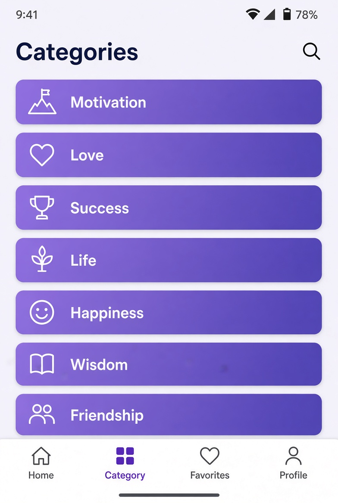
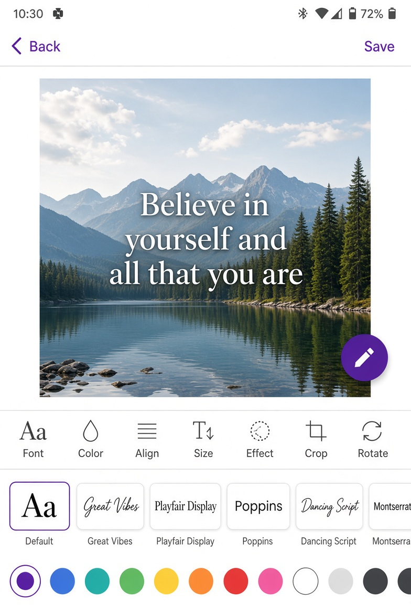
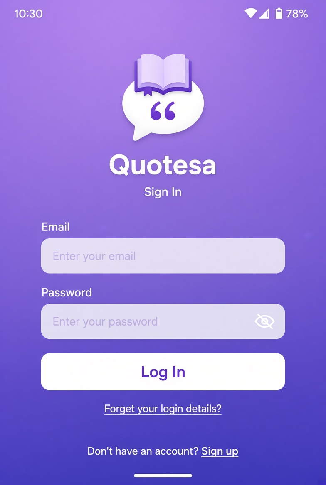
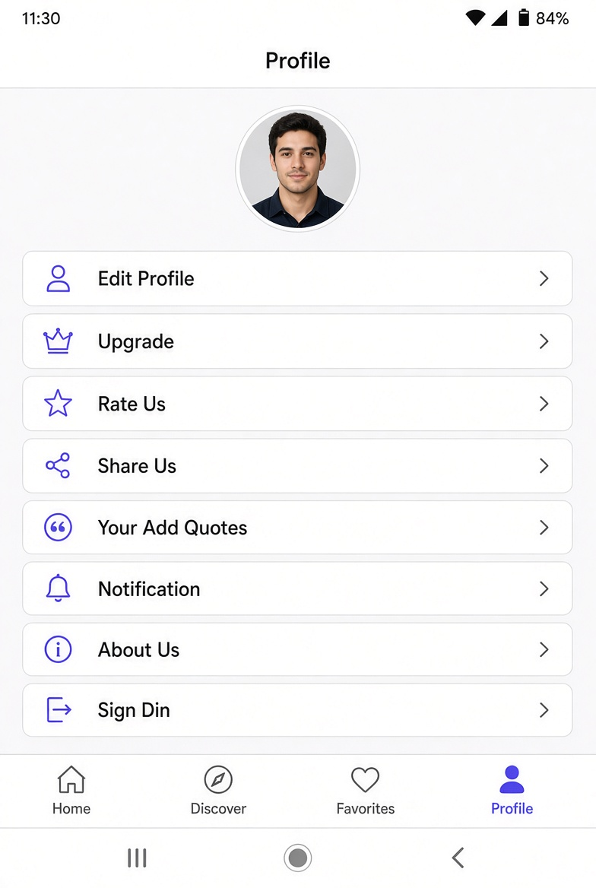

# Quotesa

### اپلیکیشن ساخت و اشتراک‌گذاری نقل‌قول‌ها

**Quotesa** بستری برای ساخت، ویرایش و اشتراک‌گذاری نقل‌قول‌های تصویری است. کاربران می‌توانند متن دلخواه خود را روی تصاویر پس‌زمینه، فونت‌های متنوع و افکت‌های گرافیکی قرار دهند، دسته‌بندی کنند، در آرشیو شخصی ذخیره کنند و با دیگران به اشتراک بگذارند.

---

## درباره پروژه

Quotesa با هدف فراهم کردن ابزاری ساده و قدرتمند برای ساخت نقل‌قول‌های بصری توسعه داده شد. ساختار برنامه بر پایه انتخاب دسته‌بندی، مشاهده نقل‌قول‌های ترند و جدید، ساخت نقل‌قول شخصی با ابزارهای ویرایش تصویر و متن، و مدیریت حساب کاربری شکل گرفته است. کاربران می‌توانند نقل‌قول‌های خود را منتشر کنند، نظر بگذارند و آرشیو شخصی بسازند.

## امکانات اصلی

- مشاهده نقل‌قول‌های جدید، ترند و دسته‌بندی‌شده
- ساخت نقل‌قول تصویری با انتخاب تصویر از گالری یا دوربین
- ویرایش متن (اندازه، رنگ، فونت، تراز و حاشیه)
- اعمال افکت‌های تصویری و فیلترهای گرافیکی
- انتخاب فونت‌های متنوع و گرادینت‌های رنگی
- برش و چرخش تصویر
- ذخیره نقل‌قول در آرشیو شخصی
- ثبت‌نام و ورود با ایمیل و رمز عبور
- تکمیل و مدیریت پروفایل کاربری
- ارسال و مشاهده نظرات روی نقل‌قول‌ها
- مشاهده نقل‌قول‌های ارسال‌شده توسط کاربر
- دریافت اعلان‌ها
- ارتقا و حذف تبلیغات (Ads Upgrade)
- پشتیبانی از حالت آفلاین برای برخی داده‌های محلی

## پیش‌نمایش صفحات اپلیکیشن

<table border="0" cellspacing="12" cellpadding="0">
  <tr>
    <td align="center">
      <b>Home</b>
    </td>
    <td align="center">
      <b>Categories</b>
    </td>
    <td align="center">
      <b>Quoted Creator</b>
    </td>
  
  <tr>
    <td width="33%">
      
    </td>
    <td width="33%">
      
    </td>
    <td width="33%">
      
    </td>
  </tr>

  <tr>
    <td align="center">
      <b>Login</b>
    </td>
    <td align="center">
      <b>Profile Screen</b>
    </td>
  </tr>
  
  <tr>
      <td width="33%">
      
    </td>
      <td width="33%">
      
    </td>
  </tr>
</table>

# Quotes | Quote & Image Creator

اپلیکیشن Quotes یک پلتفرم اندرویدی برای مشاهده، اشتراک‌گذاری و ساخت تصاویر متنی با نقل‌قول‌ها و جملات الهام‌بخش است. کاربران می‌توانند مجموعه‌ای از نقل‌قول‌ها را در دسته‌بندی‌های مختلف مشاهده کنند، آثار موردعلاقه خود را ذخیره کنند و با استفاده از ابزارهای طراحی داخلی، تصاویر اختصاصی با متن و سبک دلخواه بسازند.

این پروژه به‌صورت فول‌استک توسعه داده شده و شامل اپلیکیشن بومی Android، بک‌اند مبتنی بر Laravel و پایگاه داده MySQL است.

---

---

## ✨ Features

### 📖 Explore Quotes
- مشاهده مجموعه نقل‌قول‌ها و جملات الهام‌بخش.
- مرور نقل‌قول‌ها بر اساس دسته‌بندی‌های مختلف.
- مشاهده نقل‌قول‌های محبوب و پرطرفدار.
- دریافت نقل‌قول‌های تصادفی.
- مشاهده جزئیات هر نقل‌قول.
- بارگذاری تدریجی محتوا برای مدیریت بهتر نمایش لیست‌ها.

### 🎨 Quote Creator
- ساخت تصاویر اختصاصی با استفاده از متن و تصاویر.
- انتخاب تصویر از گالری.
- استفاده از پس‌زمینه‌های رنگی و گرادیانی.
- افزودن و ویرایش متن روی تصاویر.
- انتخاب فونت از مجموعه فونت‌های متنوع.
- تغییر اندازه، رنگ و موقعیت متن.
- تنظیم نحوه تراز متن.
- چرخش و تنظیم عناصر طراحی.
- اعمال افکت‌های تصویری مختلف.
- ذخیره تصویر نهایی در حافظه دستگاه.

### ❤️ Personal Collection
- ذخیره نقل‌قول‌های موردعلاقه در آرشیو شخصی.
- حذف موارد ذخیره‌شده.
- مشاهده آرشیو نقل‌قول‌ها.
- دانلود تصاویر نقل‌قول‌ها.
- اشتراک‌گذاری تصاویر با سایر اپلیکیشن‌ها.

### 💬 User Interaction
- ثبت نظر برای نقل‌قول‌ها.
- مشاهده نظرات سایر کاربران.
- مدیریت محتوای ارسال‌شده توسط کاربر.
- ثبت و ارسال نقل‌قول‌های اختصاصی برای انتشار در برنامه.
- مشاهده وضعیت نقل‌قول‌های ارسال‌شده و پیام‌های مربوط به بررسی آن‌ها.

### 👤 Account Management
- ایجاد حساب کاربری.
- ورود به حساب کاربری.
- بازیابی رمز عبور.
- ویرایش اطلاعات پروفایل.
- مشاهده اطلاعات حساب کاربری.
- خروج از حساب کاربری.

### 🔔 Notifications
- مدیریت یادآوری‌ها و اعلان‌های برنامه.
- پشتیبانی از دریافت مجدد اعلان‌های زمان‌بندی‌شده پس از راه‌اندازی مجدد دستگاه.

---

## 🛠 Tech Stack

| Layer | Technologies |
|---|---|
| Android | Java |
| UI | XML, Android SDK |
| Architecture / Networking | Retrofit, REST API |
| JSON Parsing | Gson |
| Image Loading | Glide, Picasso |
| Image Processing | ImageFilters |
| Backend | PHP, Laravel |
| Database | MySQL |

---

## 🏗 Architecture & Implementation

### Android Application
اپلیکیشن با استفاده از Java و Android SDK به‌صورت Native توسعه داده شده است.

- طراحی رابط کاربری با XML و کامپوننت‌های استاندارد اندروید.
- استفاده از Fragment و Activity برای مدیریت صفحات و جریان‌های مختلف برنامه.
- استفاده از RecyclerView و Adapter برای نمایش مجموعه داده‌ها.
- پیاده‌سازی ارتباط با بک‌اند از طریق Retrofit و REST API.
- پردازش پاسخ‌های JSON با Gson.
- مدیریت بارگذاری و نمایش تصاویر با Glide و Picasso.
- پیاده‌سازی ابزارهای ویرایش تصویر و طراحی محتوای متنی.
- مدیریت اطلاعات نشست کاربر در SharedPreferences.

### Backend
بک‌اند پروژه با PHP و فریم‌ورک Laravel توسعه داده شده است.

- طراحی و پیاده‌سازی APIهای موردنیاز اپلیکیشن.
- مدیریت کاربران و اطلاعات حساب کاربری.
- مدیریت دسته‌بندی‌ها و نقل‌قول‌ها.
- مدیریت آرشیو شخصی کاربران.
- مدیریت نظرات و محتوای ارسالی کاربران.
- پردازش درخواست‌های اپلیکیشن و تبادل اطلاعات از طریق API.

### Database
پایگاه داده MySQL برای ذخیره‌سازی و مدیریت اطلاعات پروژه استفاده شده است.

- اطلاعات کاربران و پروفایل‌ها.
- دسته‌بندی‌ها و نقل‌قول‌ها.
- آرشیو شخصی کاربران.
- نظرات و تعاملات کاربران.
- اطلاعات محتوای ارسالی و وضعیت بررسی آن.

---

## 👩‍💻 Development & Responsibilities

**Role: Full-Stack Android Developer**

طراحی و توسعه کامل پروژه از ابتدا تا مرحله پیاده‌سازی، شامل:

- تحلیل نیازمندی‌ها و طراحی ساختار اپلیکیشن.
- توسعه اپلیکیشن Native Android با Java و XML.
- طراحی و پیاده‌سازی رابط کاربری و جریان‌های تعاملی.
- توسعه ابزار ساخت و ویرایش تصاویر نقل‌قول.
- طراحی و توسعه بک‌اند با PHP و Laravel.
- طراحی و پیاده‌سازی REST APIها.
- طراحی و مدیریت پایگاه داده MySQL.
- یکپارچه‌سازی اپلیکیشن اندروید با بک‌اند.
- پیاده‌سازی قابلیت‌های مدیریت کاربران و محتوای برنامه.

---

## 🔒 Source Code & Privacy

این مخزن با هدف معرفی پروژه در پورتفولیوی حرفه‌ای ایجاد شده است.

به دلیل ماهیت فریلنسری پروژه و حفظ حقوق مالکیت و اطلاعات کارفرما، سورس‌کد اصلی اپلیکیشن و بک‌اند در این مخزن عمومی منتشر نشده است.

تصاویر و توضیحات ارائه‌شده صرفاً برای نمایش قابلیت‌ها، تکنولوژی‌ها و تجربه توسعه پروژه هستند.

---

## 📌 Project Information

| Item | Description |
|---|---|
| Project Name | Quotes |
| Platform | Android |
| Development Type | Freelance Project |
| Application Type | Quote & Image Creator |
| Android Language | Java |
| Backend Language | PHP |
| Backend Framework | Laravel |
| Database | MySQL |
| Developer Role | Full-Stack Android Developer |
